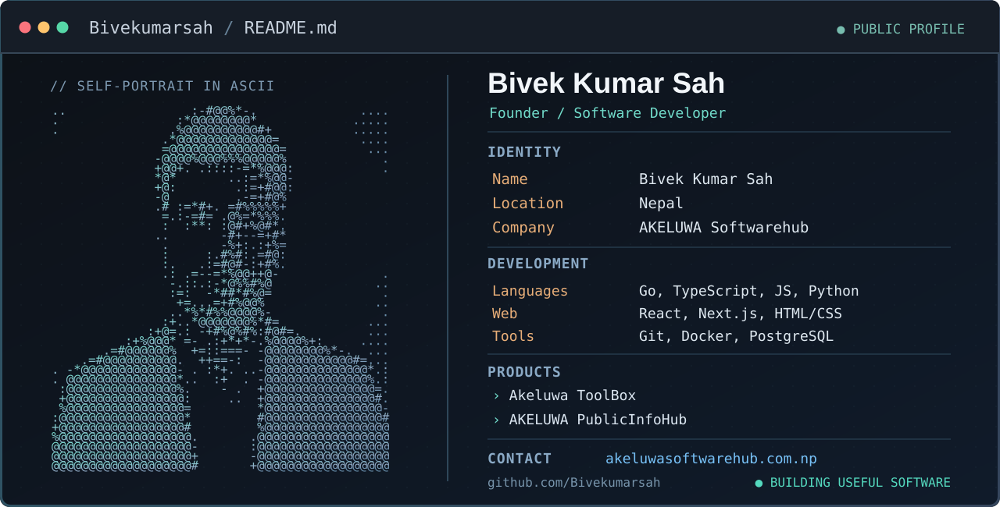

<!-- The custom dark terminal card includes ASCII artwork derived from my own portrait. -->

  

  
<b>Building useful software. Shipping dependable digital products.</b>

  
  
  

### About

I'm **Bivek Kumar Sah**, a developer based in Nepal, building practical web applications and digital products through **[AKELUWA Softwarehub](https://www.akeluwasoftwarehub.com.np/)**, a registered Nepal-based software company.

### Featured projects

| Project | What it does |
|:--|:--|
| [AKELUWA Softwarehub](https://github.com/Bivekumarsah/AKELUWA-SH-Full-Stack) | Software development, business systems and company website · [Visit website](https://www.akeluwasoftwarehub.com.np/) |
| [Akeluwa ToolBox](https://github.com/Bivekumarsah/AkeluwaToolBox) | Browser-based PDF, photo, file-conversion and everyday tools · [Open tools](https://www.akeluwasoftwarehub.com.np/akeluwatoolbox/) |
| [AKELUWA PublicInfoHub](https://github.com/Bivekumarsah/AKELUWA-PublicInfoHub) | Independent Nepal public-information directory and citizen utilities · [Explore](https://www.akeluwasoftwarehub.com.np/publicinfohub/) |

PublicInfoHub is an independent information platform, not a government service.

  
 &nbsp; 

  📍 Nepal &nbsp; · &nbsp; <a href="https://www.akeluwasoftwarehub.com.np/">AKELUWA Softwarehub</a> &nbsp; · &nbsp; <a href="mailto:akeluwasoftwarehub@gmail.com">Contact</a>

