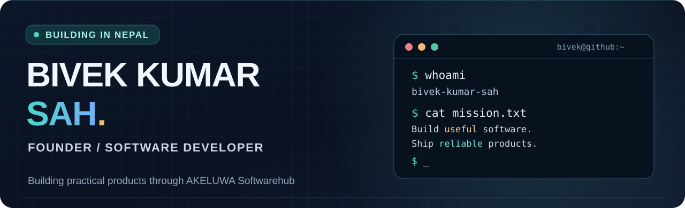
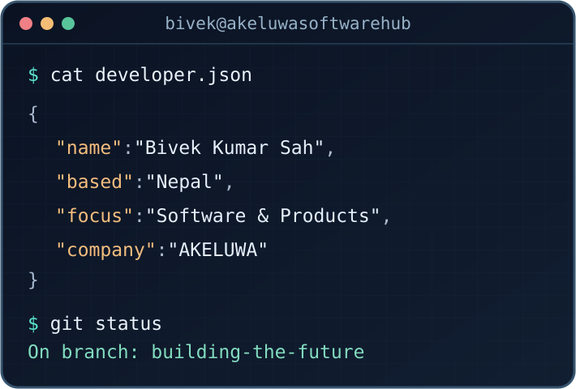

<!-- Personal profile of Bivek Kumar Sah | github.com/Bivekumarsah -->
<!-- The dark graphics are original, locally hosted SVGs in this repository. -->

<div align="center">
  
</div>

<div align="center">
  <h3>Turning ideas into reliable digital experiences.</h3>
  <p><b>Software Developer</b> &nbsp;•&nbsp; <b>Building AKELUWA Softwarehub</b> &nbsp;•&nbsp; <b>Nepal 🇳🇵</b></p>
  <a href="https://www.akeluwasoftwarehub.com.np/"></a>
  <a href="https://github.com/Bivekumarsah?tab=repositories"></a>
  <a href="mailto:akeluwasoftwarehub@gmail.com"></a>
</div>

<br/>

<table>
  <tr>
    <td valign="top" width="55%">
      <h3>01 / ABOUT ME</h3>
      <p>Hi, I'm <b>Bivek Kumar Sah</b>, a developer based in Nepal who enjoys building practical applications and solving real-world problems with technology.</p>
      <p>I'm developing <b><a href="https://www.akeluwasoftwarehub.com.np/">AKELUWA Softwarehub</a></b>, a registered Nepal-based software company, alongside useful digital products for everyday work and access to information.</p>
      <ul>
        <li>🧩 Focused on software engineering, web applications, and useful digital tools.</li>
        <li>🚀 Building <a href="https://www.akeluwasoftwarehub.com.np/akeluwatoolbox/">Akeluwa ToolBox</a> and <a href="https://www.akeluwasoftwarehub.com.np/publicinfohub/">AKELUWA PublicInfoHub</a>.</li>
        <li>🛠️ Interested in backend systems, user experience, automation, and continuous improvement.</li>
        <li>🌏 Based in Nepal. Building for users anywhere.</li>
      </ul>
    </td>
    <td valign="middle" width="45%">
      
    </td>
  </tr>
</table>

---

### 02 / BUILDING AT AKELUWA

> **AKELUWA Softwarehub** — A registered software company in Nepal developing web applications, software systems, and digital products.

| Product | What it does | Explore |
|:--|:--|:--|
| **AKELUWA Softwarehub** | Software development, technology services, and the home of our products. | [Website ↗](https://www.akeluwasoftwarehub.com.np/) · [Source ↗](https://github.com/Bivekumarsah/AKELUWA-SH-Full-Stack) |
| **Akeluwa ToolBox** | Useful online PDF, photo, conversion, and everyday file tools. | [Tools ↗](https://www.akeluwasoftwarehub.com.np/akeluwatoolbox/) · [Source ↗](https://github.com/Bivekumarsah/AkeluwaToolBox) |
| **AKELUWA PublicInfoHub** | Independent Nepal public-information directory and citizen utilities. **Not a government service.** | [Directory ↗](https://www.akeluwasoftwarehub.com.np/publicinfohub/) · [Source ↗](https://github.com/Bivekumarsah/AKELUWA-PublicInfoHub) |

### 03 / TECHNOLOGIES & TOOLS

<div align="center">
  
  
  
  
  
  
  
  
  
  
</div>

### 04 / FEATURED REPOSITORIES

- **[AKELUWA-SH-Full-Stack](https://github.com/Bivekumarsah/AKELUWA-SH-Full-Stack)** — Company website and full-stack platform.
- **[AkeluwaToolBox](https://github.com/Bivekumarsah/AkeluwaToolBox)** — Browser-based PDF, image, and digital utility tools.
- **[AKELUWA-PublicInfoHub](https://github.com/Bivekumarsah/AKELUWA-PublicInfoHub)** — Nepal public information, offices, and citizen utilities.
- **[go-fintech-transaction-api](https://github.com/Bivekumarsah/go-fintech-transaction-api)** — Go backend project.

### 05 / CURRENT FOCUS

```text
$ git status --short
+ Build useful products
+ Improve reliability and accessibility
+ Learn, experiment, and ship thoughtfully
```

---

<div align="center">
  <b>Open to meaningful projects, technical collaboration, and thoughtful product ideas.</b>
  <br/><br/>
  <a href="https://www.akeluwasoftwarehub.com.np/">Company Website</a> &nbsp;•&nbsp;
  <a href="https://github.com/Bivekumarsah?tab=repositories">GitHub Projects</a> &nbsp;•&nbsp;
  <a href="mailto:akeluwasoftwarehub@gmail.com">Business Contact</a>
  <br/><br/>
  <sub>Built with care in Nepal 🇳🇵 · © AKELUWA Softwarehub</sub>
</div>
